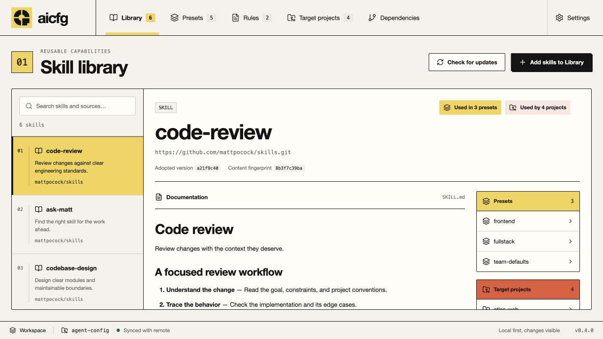
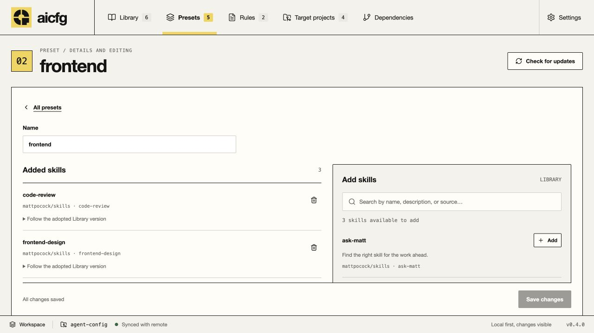
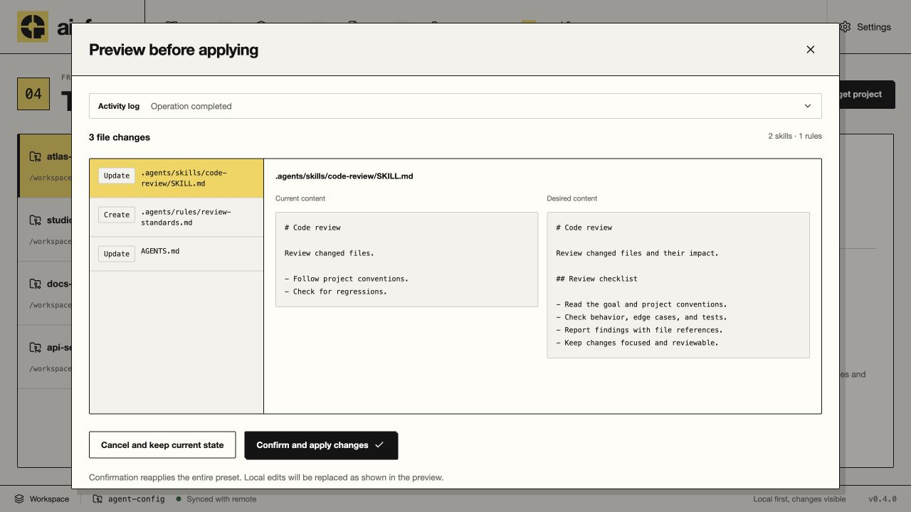
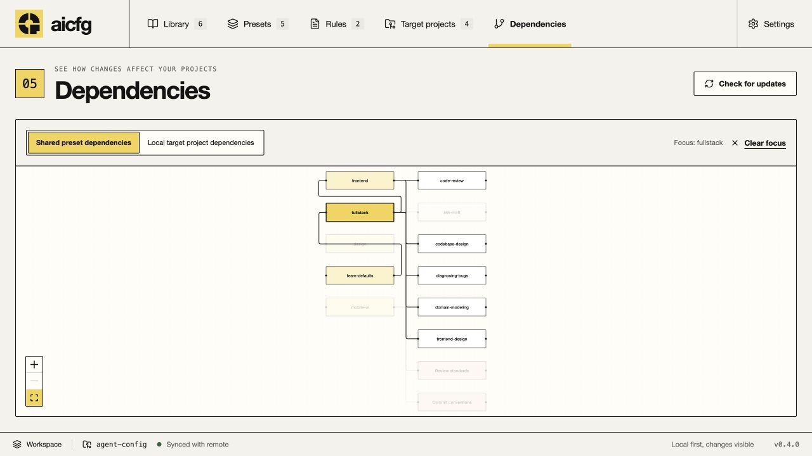

<p align="center">
  
</p>

<h1 align="center">aicfg</h1>

<p align="center">
  <strong>Your agent setup, organized.</strong><br />
  Collect skills, compose reusable presets, and review changes across your repositories.
</p>

<p align="center">
  <a href="https://github.com/alkaid-tech/aicfg/releases/latest">Download for macOS</a>
  · <a href="docs/usage.md">User guide</a>
  · <a href="docs/development.md">Development</a>
  · <a href="CONTRIBUTING.md">Contributing</a>
</p>

<p align="center">Local-first · Git-owned configuration · Apple Silicon &amp; Intel</p>

<p align="center">
  
</p>

<p align="center"><sub>The Skill Library and usage inspector. Screenshots show the application with example configuration and content.</sub></p>

## Why aicfg?

Keep your agent capabilities in one versioned collection. Reuse them across projects, choose the setup each repository needs, and review the resulting files before applying updates.

- **A versioned skill library.** Discover skills from GitHub or local Git repositories, read their documentation, and adopt specific source versions.
- **Composable presets.** Combine skills, scoped Markdown rules, and other presets. Included presets remain linked, and cyclic references are rejected.
- **A setup for each project.** Select presets and agent adapters independently for every target repository, with per-project skill exclusions.
- **Changes you can review.** Compare current and desired file contents, resolve version and ownership conflicts, then explicitly confirm application.
- **Visible relationships.** See which presets and projects use a skill, navigate to their editors, and focus dependencies in an interactive graph.
- **Configuration you own.** Store shared definitions in your own Git repository, using your existing Git identity and authentication.

The interface supports **English, Simplified Chinese, and Japanese**, including an option to follow your system language.

## Install

1. Download the **macOS Universal** DMG or app ZIP from the [latest release](https://github.com/alkaid-tech/aicfg/releases/latest).
2. Open the download and move **aicfg.app** to **Applications**.
3. Make sure **Git** and **Node.js 22.12 or newer**, including npm/npx, are installed. aicfg discovers your shell's `PATH` when launched from Finder.

Downloads support both Apple Silicon and Intel. Builds marked `_unsigned` are previews without Apple Developer ID signing or notarization; check the release notes for macOS first-launch instructions. See the [release guide](docs/releases.md) for distribution details.

## From skills to working projects

| Step           | What you do                                                                                                                                                    |
| -------------- | -------------------------------------------------------------------------------------------------------------------------------------------------------------- |
| **1. Connect** | Open, initialize, or clone a configuration repository in its own directory.                                                                                    |
| **2. Collect** | Add a GitHub URL, `owner/repo`, a GitHub tree URL, or a local Git repository. Choose individual skills to add to the Library.                                  |
| **3. Compose** | Create presets, add skills and Markdown rules, and include other presets when useful.                                                                          |
| **4. Apply**   | Add a target repository, choose its presets and adapters, then select **Save and preview changes**. Review the files and choose **Confirm and apply changes**. |

Adding a skill to the Library does not install it into a project. Adopting an update and applying it to each target are separate steps.

Saving shared configuration creates a local Git commit and attempts to push it. aicfg never stages or commits changes in your target repositories. Handwritten instructions outside aicfg's managed regions are preserved.

For source discovery, update handling, conflict decisions, and recovery, see the [user guide](docs/usage.md).

## A closer look

<details>
<summary><strong>Compose reusable presets</strong></summary>

Search the Library, add skills, and choose whether each one follows its adopted version or a pinned source commit. Add rules and include other presets on the same detail page.



</details>

<details>
<summary><strong>Preview file changes before applying</strong></summary>

Review the current and desired contents of every changed file. Resolve conflicts before confirming application, and keep existing handwritten content outside managed regions.



</details>

<details>
<summary><strong>Explore dependencies</strong></summary>

Switch between shared presets and local target projects. Click a node to focus its dependencies and fade unrelated branches; clear focus to return to the full graph.



</details>

## Agent adapters

Enable adapters separately for each target project.

| Adapter            | Output                                                                                        |
| ------------------ | --------------------------------------------------------------------------------------------- |
| **Generic Agents** | Skills and rules under `.agents/`, plus managed instruction regions in `AGENTS.md`.           |
| **Claude**         | Relative `.claude/skills` and `.claude/rules` links, with a managed reference in `CLAUDE.md`. |
| **Cursor**         | Scoped `.cursor/rules/*.mdc` rule files.                                                      |

See [adapter output](docs/configuration.md#adapter-output) for the generated layout and ownership rules.

## Where your configuration lives

| Data                                                                   | Location                                                              |
| ---------------------------------------------------------------------- | --------------------------------------------------------------------- |
| Library, presets, and rule definitions                                 | Your configuration Git repository.                                    |
| Local project connections, state, and skill snapshots                  | The configuration repository's Git-ignored `.aicfg-local/` directory. |
| A target's selected presets, adapters, exclusions, and version choices | `.aicfg.toml` in that target repository.                              |

The configuration repository and target repositories are separate. Sharing configuration does not share this computer's local project connections. See the [configuration reference](docs/configuration.md) for file formats and storage details.

## Build from source

For development, you also need **Rust stable** and **Xcode Command Line Tools** on macOS.

```sh
git clone https://github.com/alkaid-tech/aicfg.git
cd aicfg/desktop
npm ci
npm run desktop
```

`npm run desktop` starts the native Tauri app with frontend hot reloading. `npm run dev` starts the browser interface alone; repository operations require the desktop runtime.

From `desktop/`, build a local application bundle with:

```sh
npm run bundle
```

The app is generated at `desktop/src-tauri/target/release/bundle/macos/aicfg.app`. For prerequisites, tests, linting, and packaging, follow the [development guide](docs/development.md).

Built with **Rust, Tauri 2, React, and TypeScript**. The desktop app currently supports macOS; see the [roadmap and limitations](docs/roadmap.md) for platform plans and current boundaries.

## Documentation

- [User guide](docs/usage.md) — connect repositories, collect skills, compose presets, and apply changes.
- [Configuration reference](docs/configuration.md) — shared definitions, local state, target settings, and adapter output.
- [Development setup](docs/development.md) — run, test, and build the application.
- [Design system](docs/design-system.md) — Signal Block branding, tokens, components, and interaction states.
- [Architecture](docs/architecture.md) — modules and the preview-to-application workflow.
- [Releases](docs/releases.md) — version policy, downloads, signing, and recovery.
- [Roadmap](docs/roadmap.md) — available behavior, limitations, and planned work.
- [Glossary](GLOSSARY.md) — project terminology.

## Contributing

Bug reports, documentation improvements, and focused pull requests are welcome. Read [CONTRIBUTING.md](CONTRIBUTING.md) for project conventions and verification requirements.

## License

[Apache License 2.0](LICENSE).
